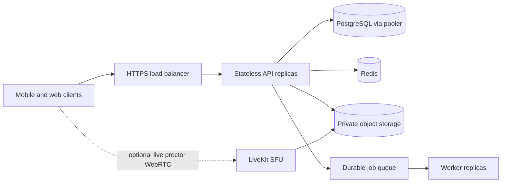

# Scaling and exam integrity architecture

Status: target architecture and staged implementation plan. The current code is not yet certified for 1,000 active exam sessions or multi-instance live duels. “1,000 concurrent users” must be measured as separate workloads: HTTP request rate, open sockets, active attempts, proctor media streams, and database writes.

## Current baseline

- The API is a NestJS modular monolith. Most request handlers are stateless, and PostgreSQL is the durable source of truth.
- Redis is already used for shared throttling, locks, cache, pub/sub, and the Socket.IO Redis adapter. Production startup requires `REDIS_URL`.
- Duel queues, live duel state, timers, reconnect state, and rematch state are process-local maps in `DuelsGateway`. Redis Socket.IO fan-out does not share that game state. The API now requires an explicit production role: `DUELS_ENGINE_ENABLED=false` on horizontally scaled HTTP replicas, and `true` on exactly one dedicated duel service. This prevents accidental multi-owner operation; it does not yet make duel state recoverable or shardable.
- Attempt autosave is synchronous with PostgreSQL. Integrity events are authenticated, rate-limited, typed, deduplicated by client event/session identifiers, and stored with server receive time, client sequence/time, app version, platform, OS version, and device model. A small explainable per-event review weight is shown in admin results; it is not a cheating verdict. The mobile client now has consent-gated camera preview, screenshot prevention/listening, and coarse microphone metering for active attempts.
- Uploaded images are stored on local disk. That is unsuitable for multi-replica evidence or content access unless the storage is moved to a shared object store.
- The mobile project is Expo managed workflow. Admin-controlled camera preview, screenshot prevention/listening, and coarse microphone metering are device-local signals; they do not supply camera frames, screen video, or audio to admins. Face detection, speech recognition, live media streaming, and installed-app scans/uninstalling are not implemented.

## Current proctoring implementation boundary

- `exam.integrity.cameraPreviewEnabled` makes the student explicitly grant camera permission before the exam starts. During the exam, a visible front-camera preview runs on the device. No frames are recorded, uploaded, or visible to admins.
- `exam.integrity.preventScreenshots` asks supported mobile platforms to block screenshots and logs screenshot callbacks where the OS reports them. It cannot reliably detect third-party recording, external cameras, mirroring, or all capture methods.
- `exam.integrity.microphoneLevelMonitoringEnabled` can request microphone permission and measure a coarse metering level while the exam is active. Only rate-limited `BACKGROUND_NOISE` events are sent; raw audio, recordings, and transcripts are not retained. This does not identify words, answer choices, or a speaker.
- The authenticated integrity ledger includes event time, session/event IDs, app and OS version, platform, and model name. The admin results page lists active attempts and provides a scoped event timeline, with an audited, in-app/push warning action for active attempts. These signals are review aids, not automatic cheating verdicts.
- Expo does not provide built-in face or speech recognition here. Android and iOS also restrict installed-app enumeration and do not let an app uninstall another app. Do not describe these as implemented checks or block students based on unsupported scans.
- A local one-shot probe of `GET /health` with 1,000 concurrent requests completed 1,000/1,000 successfully at 387.8 requests/second; p50 latency was 1,346 ms, p95 2,060 ms, and p99 2,164 ms. This is a dependency-check smoke test, not proof of 1,000 active exam capacity. The earlier rate-limited probe (4,360 requests in five seconds, 4,060 HTTP 429) remains invalid for capacity sizing.

## Measured capacity (local run, 2026-10-12)

**What this is:** a pre-launch load test on one 4-core / 8 GB developer machine, where the load generator, Postgres, Redis, nginx and every API process shared the same cores. It shows behaviour and per-request cost; it is **not** a production capacity certificate (no 30-minute soak, no managed Postgres/pooler, no real network or devices). Re-run the same scenarios on staging before launch.

Stack: nginx (least-connections) → 3 stateless HTTP replicas (`DUELS_ENGINE_ENABLED=false`, `ANSWER_ANALYSIS_ENABLED=false`, 20 DB connections each) + 1 dedicated duel engine. 10,000 seeded users.

| Scenario | Result |
|---|---|
| 10,000 users: 1,000 concurrent exam sessions (autosave ~15 s, heartbeat, resync, submit) + 9,000 users browsing about once a minute, arrivals spread over 4 min (48,013 requests) | 0 server errors. Exam start p50 142 ms / p95 865 ms; autosave p50 60 ms / p95 502 ms; Home p50 119 ms / p95 825 ms. 1,000/1,000 attempts submitted; 27,000/27,000 acknowledged answers stored. Event-loop lag p99 ≤ ~170 ms. |
| 1,000 students start within 2 s (tournament start herd) | 0 errors, nothing lost, but slow: start p50 ≈ 8 s, submit p50 ≈ 5 s (CPU-bound: a start costs ~25 ms CPU, a submit ~28 ms). |
| Same 10,000 users but all arriving in 60 s | Overloaded this box: 14% errors (timeouts, 502, pool exhaustion). Pool exhaustion now returns `503 + Retry-After` instead of a generic 500. |
| 1,000 concurrent duel sockets, 500 live duels | 0 connect failures, 0 disconnects; 4,998/4,998 answers accepted (ack p50 6 ms, p99 97 ms); server RSS ~320 MB. |

Per-core CPU cost on this hardware (use for sizing; one core ≈ 1000 / ms-per-request): app config 2.3 ms, `GET /me` 6 ms, autosave 5–10 ms, event/paper/result 4–5 ms, Home ~21 ms (≈ 48/s), start ~25 ms (≈ 40/s), submit ~28 ms (≈ 35/s).
Rule of thumb from these numbers: the steady 10,000-user scenario needs about 2 busy API cores; a 1,000-student start herd needs ~25 core-seconds, so with 4 API vCPUs the herd drains in about 6 s. To flatten it, have the app delay `start` by a random 0–10 s at a scheduled start time, and scale API replicas before large events.

Operational switches added from this work:
- `ANSWER_ANALYSIS_ENABLED=false` on HTTP replicas; run analysis on one dedicated worker (it is O(finishers) per attempt).
- `/health` now reports `eventLoopLagMs {p50,p99,max}` since the last read; alert or scale on p99 (healthy < ~100 ms).
- Set `connection_limit` and `pool_timeout` in `DATABASE_URL` so `replicas × connection_limit` stays below Postgres `max_connections` (or use a pooler). `pool_timeout=10` makes overload fail fast.
- Public config, Home content (banners, exams, tournaments, leaderboard), and the frozen test tree are cached in-process for 2–10 s; the authenticated user row for 5 s. A suspension or content edit therefore reaches every replica within ~5–10 s.

## Target topology for 1,000 active students

### API and socket tier

1. Run at least two API replicas behind TLS termination and health-aware load balancing with `DUELS_ENGINE_ENABLED=false`. Run one dedicated duel service with `DUELS_ENGINE_ENABLED=true`; route `/duels` Socket.IO traffic only there while ordinary HTTP traffic scales across API replicas. Use graceful shutdown: stop accepting new work, drain HTTP requests and sockets, then exit.
2. Keep the Redis Socket.IO adapter, but treat it only as cross-node message fan-out. The current role split provides one owner for duels, not duel horizontal scaling. Next, assign each duel to a durable owner/partition and route every state transition to that owner, or move state transitions to Redis scripts/transactions with monotonically increasing versions and idempotent commands. Persist enough state to recover after worker loss. Never let two replicas independently advance the same duel.
3. Configure load-balancer WebSocket timeouts and keepalives. Use sticky sessions only if the Socket.IO deployment mode requires polling; WebSocket-only transport can avoid polling affinity, but reconnection still needs shared state.
4. Add per-route and per-user rate limits, payload limits, and concurrency limits. Separate API liveness from readiness; readiness should verify dependencies needed by that instance without turning transient Redis trouble into a restart storm.

### PostgreSQL and Redis

- Place a connection pooler between API replicas and Postgres. Set Prisma connection limits from the pooler budget so replica count cannot multiply connections beyond the database capacity.
- Keep transaction scopes short. Avoid per-answer serial writes inside a transaction; batch answer upserts and scoring writes. Add indexes only from measured query plans and production-like data.
- Give Redis distinct capacity/alerting for cache, locks, Socket.IO pub/sub, and queues. Use separate logical key prefixes and finite TTLs. Do not use Redis Pub/Sub as the only delivery mechanism for work that must survive disconnects; use a durable queue/outbox.
- Move local uploads to private object storage behind `StorageService`. Evidence must use private access, short-lived signed URLs, encryption, and explicit retention/deletion jobs.

### Background work

Move auto-submit, tournament lifecycle, notification fan-out, result generation, evidence processing, and cleanup into worker processes. Claim work through a durable queue or transactional outbox, with idempotency keys, bounded retries, dead-letter visibility, and job-level metrics. The API should enqueue and return; workers should not hold user requests open for long fan-outs.

## Capacity definition and acceptance gates

Do not claim a “1,000 user” capacity from connected sockets alone. Establish a workload profile with concurrent active attempts, answer autosave cadence, number of live video streams, notification fan-out, reconnect rate, and peak login traffic. Run load tests against a production-like staging stack before launch.

Minimum release gates:

- 1,000 authenticated active exam sessions sustained for 30 minutes, including the configured autosave cadence.
- A separate 1,000 open WebSocket test, plus reconnect and rolling-restart tests. Test actual duel traffic separately from idle sockets.
- No lost accepted answers or duplicate scoring when requests retry, API replicas restart, or workers retry jobs.
- Record p50/p95/p99 latency, error rate, DB pool wait, query time, Redis latency/memory, event-loop lag, queue age, socket disconnects, and worker retry counts.
- Keep headroom under peak: alert on sustained resource saturation and queue growth rather than sizing only to a single successful run.

These are acceptance targets, not a sizing claim. CPU/memory/replica counts must come from the measured run and chosen cloud/database plans.

## Bot quality

- Bot identity remains server-side; duel payloads use the same opponent shape for human and bot opponents, with synthetic ids for bots.
- Keep bots restricted to practice duels that have no entry fee, prize, or reward eligibility. Preserve this as a server-side invariant, not a client setting.
- Bot answers and response timings now use a per-match seed stored server-side, plus a bounded match-level performance offset. This makes a match replayable for support review without exposing the bot marker or seed in student DTOs.
- Continue improving behavior through a versioned bot policy: rating/difficulty calibration, bounded reaction-time distributions, and occasional skips. Do not tune bots from an individual student’s sensitive proctoring data.
- Track bot win rates by rating band, exam, and difficulty, and alert on drift. Recalibrate from aggregate outcomes; do not expose private student data in bot analytics.

## Cheat-detection engine

Treat detection as an explainable risk signal for human review, not an automatic guilt verdict. A student may have accessibility needs, poor connectivity, shared living space, or device limitations. A single signal such as looking away, a background noise event, or app interruption must not automatically disqualify a student.

Pipeline:

1. Client submits a bounded, schema-validated event with `attemptId`, per-attempt device-session id, monotonically increasing sequence, client event id, event type, client time, and a small allow-listed metadata object. Server adds authoritative receive time, user ownership, app version, and server event id.
2. Reject events for attempts not owned by the caller or not in progress. Deduplicate by `(attemptId, clientEventId)`, cap event rate and body size, and store device details as normalized, allow-listed fields. Never accept arbitrary metadata blobs as trusted facts.
3. Preserve raw event facts separately from a versioned risk assessment. Each assessment records signal, confidence, source (client/server/reviewer), policy version, explanation, and evidence reference. The score is reproducible and can be recomputed when policy changes.
4. Correlate independent signals over a time window. Keep confidence and source reliability visible to reviewers. Client-reported root/emulator checks are claims, not tamper-proof proof; platform attestation can raise confidence but is not infallible.
5. Apply progressive responses: student-facing warning or recovery first; flag for review where warranted; human decision with reason and appeal path for consequential actions. Preserve an audit trail of reviewer actions.

Signals should be limited to assessment integrity: exam app backgrounding, connection interruptions, answer timing/change patterns, duplicate active attempt sessions, and explicitly enabled camera/screen/microphone signals. Do not collect installed-app inventories, contacts, location, or unrelated device activity.

## Camera, screen, and microphone monitoring

The current exam player requests session-scoped consent and permissions, shows a visible camera preview/monitoring state, prevents screenshots where the platform allows it, listens for screenshot events, and can emit rate-limited coarse microphone-level signals. It does not record or upload raw camera, screen, or microphone media. Any future evidence capture requires native implementation, clear pre-exam disclosure and consent, permissions granted for that session, an accessible alternative assessment path, and a visible active-monitoring indicator. Stop capture immediately when the attempt ends, is submitted, or the student withdraws consent.

- **Camera:** prefer on-device face-presence/lighting checks that emit coarse events. Avoid face identification or identity templates. Send a still image only when a separately disclosed policy requires review, and store it in private object storage with a short, documented retention period.
- **Screen:** collect OS-provided capture/recording state where supported. Do not secretly record or stream the screen. Explain unsupported platforms before enrollment; do not treat missing platform APIs as misconduct.
- **Microphone:** prefer on-device voice activity/noise events. Do not retain raw audio or transcripts by default. If a specific assessment requires a live proctor, make the audio stream explicit, time-bounded, and accessible only to assigned proctors; never turn it on in the background.
- **Device/session audit:** record app version, OS/platform family, model family where available, a random per-install identifier, permission state, integrity-check capability/result, and session start/end. Avoid persistent hardware identifiers and do not fingerprint across unrelated sessions. Make the event timeline available to authorized reviewers and the student through an appeal process.
- **Security and retention:** encrypt transport and storage, scope access by role and attempt, audit every evidence view/export, expire media automatically, and document deletion behavior. Keep metadata retention distinct from media retention.

Because the app supports minors, the exact consent, retention, and alternative-assessment policy must be reviewed for the deployment jurisdictions before enabling any monitoring. The implemented camera preview, screenshot controls, and coarse microphone meter may be described only with their current limits. Face recognition, speech recognition, raw media capture, live admin streaming, and installed-app checks remain unavailable until separately designed, disclosed, and implemented.

## Staged delivery

1. **Scale-safe baseline:** set the duel role split; externalize uploads; define deployment replica/connection budgets; instrument API, DB, Redis, and sockets; add load-test scenarios; move scheduled jobs to durable workers.
2. **Distributed duel ownership:** implement persisted duel state and idempotent versioned transitions; test failover, reconnect, and rolling deploys across multiple replicas.
3. **Integrity event foundation:** completed first slice: typed event schema, per-attempt session metadata, event id/sequence deduplication, per-route rate limit, explainable risk weights, and admin result triage. Still needed: explicit retention controls, reviewer audit workflow, richer device-session views, and independent signal validation. Keep media disabled.
4. **Native monitoring pilots:** only after disclosures, consent UX, retention/access controls, platform capability handling, and an alternative pathway are ready. Pilot one signal at a time and measure false-positive and appeal rates before any consequential use.

## Anti-cheat hardening (current implementation)

What is enforced where. The rule behind every row: **the phone is untrusted**; only a signed platform proof or a server-side computation can block a student.

| Threat | Control | Trust level |
| --- | --- | --- |
| Rooted/jailbroken, emulator, re-signed or sideloaded app, hooking | Play Integrity (`MEETS_DEVICE_INTEGRITY`, `PLAY_RECOGNIZED`, signing-cert digest) / App Attest (Apple-rooted chain, app id, counter) verified in `AttestationService`, bound to a one-time server challenge. Preflight blocks; a failed periodic re-check raises a CRITICAL flag. | Server-verified |
| Screen-sharing, remote control, overlays | Play Integrity `appAccessRiskVerdict` (`*_CAPTURING`, `*_CONTROLLING`, `*_OVERLAYS`) blocks at start and on every re-attest. On device: installed remote-control package list, enabled accessibility services, overlays hidden (`setHideOverlayWindows`, `filterTouchesWhenObscured`). | Server-verified (Google) + device claims |
| Screenshots, screen recording, casting, mirroring | `FLAG_SECURE` on Android and a secure-layer render on iOS (`DeviceIntegrity.setSecure`) plus `expo-screen-capture`: captures show black. Recording/mirroring state is also reported as a flag. | Enforced by the OS on the device |
| Second phone, shared account | Per-install id + attested key; `MULTIPLE_DEVICES` flag; device bans (hashed). | Server |
| Face absent / second person / looking away, spoken answers, talking, noise | On-device ML Kit and speech recognition emit flags with a still or the matched phrase. No raw audio or video is stored. | Device claim, reviewed by humans |
| Answer copying, scripted answers | `answer-patterns.ts`: identical-wrong-answer pairs scored as a probability (Poisson-binomial tail, default p < 1e-4), implausibly fast correct answers, near-constant timing. Runs after submit (`AnswerAnalysisService`). | Server, statistical |
| Consequences | Server rules add points and warn; optional auto-end. **Disqualify**, **account block** and **device ban** are human actions, audited, with an appeal path. | Human |

### Setup checklist (nothing blocks or verifies until this is done)

1. **Android**: link the app to a Google Cloud project in Play Console → App integrity; enable the Play Integrity API; create a service account, grant it access, and set `PLAY_INTEGRITY_SA_JSON` on the API. In Admin → Settings → Proctoring set the package name, Google Cloud project number and the Play app-signing certificate SHA-256 digest(s).
2. **iOS**: add the App Attest capability, set the App ID (`TEAMID.bundleId`) in settings. Development builds use Apple's development environment (accepted outside production only).
3. Build a **development/production build** with EAS (the local `device-integrity` module and `@expo/app-integrity` are native; Expo Go cannot run proctored tests).
4. Set `DEVICE_HASH_SALT` once.
5. Adding a package to the blocked-app list takes effect for the server filter at once, but the on-device scan can only see packages declared in `modules/device-integrity/android/src/main/AndroidManifest.xml` `<queries>` (Android 11+), which needs a new app build.

### Known limits (be honest with students and admins)

- iOS gives apps no API to list other installed apps or to see other apps' accessibility use; iOS relies on App Attest plus capture state. Mirroring/recording is blanked, not prevented.
- A secure surface hides pixels. It does not stop a person reading the questions off the screen with a second camera, which is what camera and speech signals and answer-pattern analysis are for.
- Accessibility-service apps that read the view hierarchy (not pixels) are not blocked by `FLAG_SECURE`; Play Integrity's controlling-app verdict and the accessibility-service check cover this and may flag some legitimate assistive tools, so the allowlist is admin-editable.
- Play Integrity `appAccessRiskVerdict` is only populated for apps Google can evaluate; treat a clean verdict as "nothing known", not proof.

### Per-exam proctoring switches and the single consent screen

- Mode is a preset: **Simple** (BASIC: device + connection check, protected screen, app-switch log), **AI** (adds on-device face, phone/object and speech detection), **Live** (camera + microphone + screen stream to proctors). Each test and tournament can override single switches (`proctorOptions`); Settings → Proctoring is a master ceiling. Resolution lives in `resolveFeatures()` (shared) and is stored on the session as `features`.
- The student sees **one** consent screen before the attempt exists. It lists each permission with its purpose and the rules, records the agreement (`consent`, with purposes and text version) and the measured connection (`network`), then starts the stream so OS prompts for camera/mic/screen happen there. A denied permission blocks the start; the timer has not begun.
- Live mode: while the screen is shared the black-screen protection is lifted (a protected window would share as black). Local face/object/speech checks are skipped because the stream owns the camera and mic. Screen sharing is Android-only (iOS needs a ReplayKit broadcast extension, not built); iOS students get camera + mic.
- Instant disqualification is opt-in per exam and limited to the flags listed in Settings; it ends the test and queues a disqualification that a reviewer can reverse. The consent text states this only when it is actually enabled.
- Phone/object detection uses ML Kit image labelling on camera frames about every 2 s. It is a general-purpose labeller, not a purpose-built phone detector: expect misses and false positives, and test thresholds before enabling instant disqualification.
- Wall view uses snapshots; live video is opened per student from the session drawer. Showing live video for every student at once is not practical at 1,000 students (one room per student).
